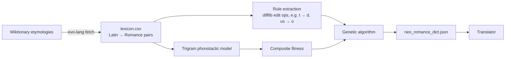

# evo-lang: evolving Latin into "Neo-Romance"

[](https://github.com/filipe-carmo/evo-lang/actions/workflows/ci.yml)

[](LICENSE)

What would a Romance language look like if it were "re-grown" from Latin by an algorithm? **evo-lang** learns real sound changes from Latin → Portuguese/Spanish/French/Italian etymologies, then uses a **genetic algorithm** to evolve Latin words into plausible new forms, scored by an n-gram model of Romance phonotactics, articulatory naturalness and (optionally) semantic stability from sentence embeddings.

```text
amicus  → amigo        tempus  → tempo        apertus → aberto
factum  → fado         tectum  → teto         vetulus → vidolo
```

```console
$ evo-lang translate ille amicus bonus in terra cum aqua
Latin:        ille amicus bonus in terra cum aqua
Neo-Romance:  lo amigo bono ene terra co aqua
```

## How it works



1. **Learn sound changes.** Each Latin/Romance pair is aligned with `difflib`; every substitution or deletion (`t → d`, `us → o`, `c → g`) becomes a rule weighted by how often it occurs.
2. **Score naturalness.** Sounds are vectors of articulatory features (place, manner, voicing, height…). A rule's naturalness falls with the feature distance it crosses, so voicing `t → d` is cheap while `p → a` is not.
3. **Evolve.** A population of variants of one Latin word evolves for N generations with elitism, rule-based mutation and half-and-half crossover.
4. **Select.** Fitness (0 to 100) combines how Romance a word looks (trigram log-likelihood, 50 pts), the naturalness of its history (30), semantic similarity of its drifting meaning vector to the original concept (10) and a Romance-style ending (10). Words that erode to under 60% of the original length are penalised.
5. **Translate.** Text is run through simple grammar changes (case endings dropped, `ille/illa` → `lo/la` articles), looked up in the evolved dictionary, and unknown words fall back to the most reliable substitution rules.

## Quick start

```bash
git clone https://github.com/filipe-carmo/evo-lang.git
cd evo-lang
python -m venv .venv && source .venv/bin/activate
pip install -e ".[dev]"            # add ",semantic" for real sentence embeddings (pulls in torch)
```

| Command | What it does |
|---|---|
| `evo-lang evolve nocte --seed 1` | Evolve one word and print the top variants with fitness, naturalness and meaning similarity |
| `evo-lang translate luna in terra` | Translate Latin text (defaults to *Lorem ipsum*) |
| `evo-lang rules --top 20` | Show the most frequent sound-change rules learned from the lexicon |
| `evo-lang build-dict` | Re-evolve `data/neo_romance_dict.json` (seeded, so reproducible) |
| `evo-lang fetch` | Download more etymologies from Wiktionary into `data/lexicon.csv` |

Settings such as generations, population size and the embedding model can be overridden with environment variables (see [`config.py`](src/evo_lang/config.py)). Without the `semantic` extra a deterministic hash embedder is used, so everything runs offline.

## Project structure

```text
src/evo_lang/
├── genetics.py     # PhoneticRule, RuleExtractor, Organism, EvolutionaryEngine (the GA)
├── fitness.py      # Trigram phonotactic model and the composite fitness function
├── phonetics.py    # Articulatory feature vectors and distances
├── semantics.py    # Sentence embeddings and Gaussian meaning drift
├── lexicon.py      # Loading and cleaning the etymology lexicon
├── grammar.py      # Case-ending loss and Latin demonstratives → articles
├── translator.py   # Dictionary lookup with rule-based fallback
├── dictionary.py   # Batch evolution of the whole vocabulary
├── fetch.py        # Wiktionary scraper
└── cli.py          # `evo-lang` command
data/
├── lexicon.csv            # ~580 Latin → PT/ES/FR/IT pairs from Wiktionary
└── neo_romance_dict.json  # 490 evolved words
tests/                     # pytest suite (rules, fitness, GA reproducibility, translator, CLI)
```

## Development

```bash
pytest -q            # 22 tests
ruff check . && ruff format --check .
```

CI runs lint and tests on Python 3.10, 3.12 and 3.13.

## Limitations

This is a toy model of historical linguistics, not a reconstruction. Spelling stands in for pronunciation, rules are context-free (they ignore stress and neighbouring sounds), and the training lexicon is small. Those are the obvious next steps: phonemic transcription, context-sensitive rules and a larger lexicon.

## License

MIT, see [LICENSE](LICENSE).
